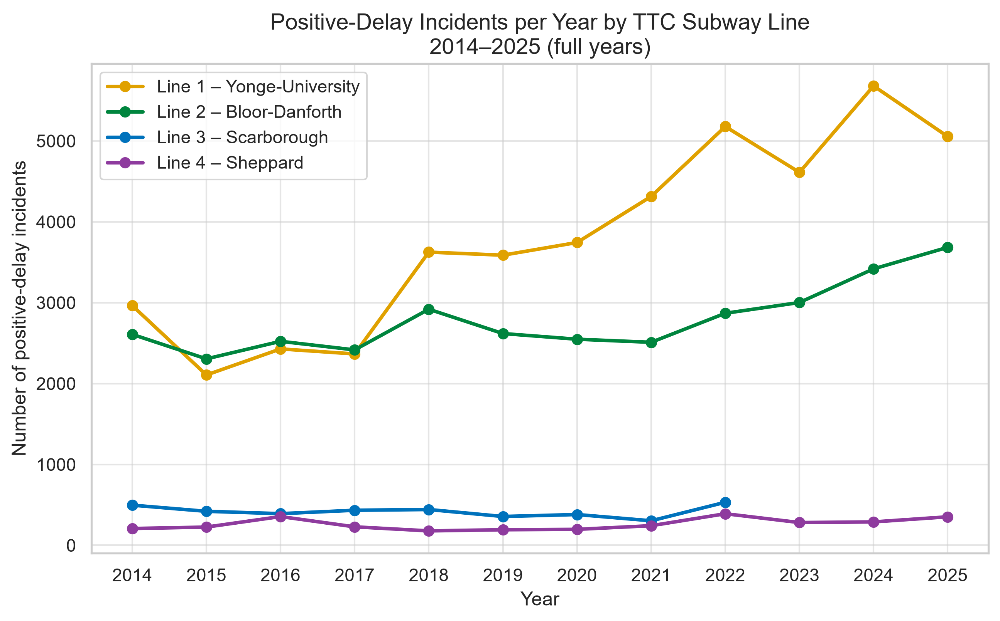
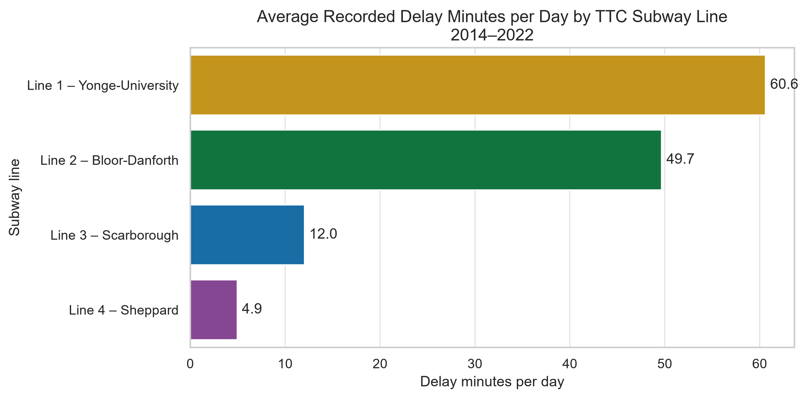
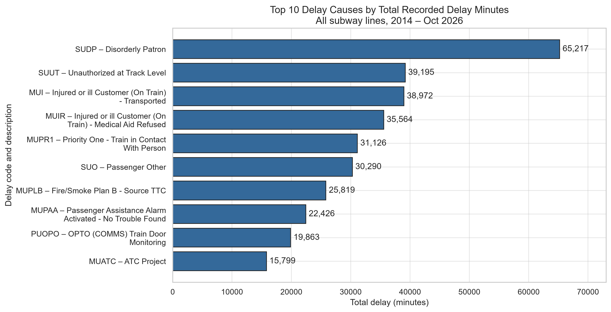
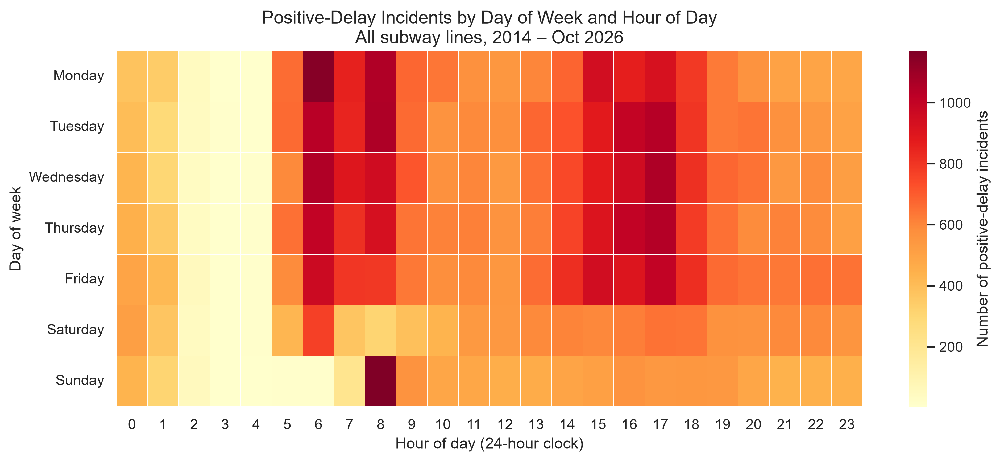

# TTC Subway Delays: Which Lines and Causes Matter Most?

INFO 5100 – Lab 8 (Data Visualization), Northeastern University.

## Overview

This lab analyses the City of Toronto's [TTC Subway Delay Data](https://open.toronto.ca/dataset/ttc-subway-delay-data/) (January 2014 – October 2026, about 273,000 recorded incidents) with **pandas**, **Matplotlib** and **Seaborn**. The notebook [`ttc_line_reliability.ipynb`](ttc_line_reliability.ipynb) loads the Excel and CSV files, cleans them, and builds four charts that answer: which lines have the most delays, what causes the most delay minutes, and when do delays happen?

## Repository structure

```
├── data/raw/                     # TTC datasets (Excel + CSV) and the README / delay-code files
├── charts/                       # the four exported chart images (PNG, 300 DPI)
├── ttc_line_reliability.ipynb    # the analysis
├── environment.yml               # conda environment
└── README.md
```

## Setup

```
conda env create -f environment.yml
conda activate info5100
```

(Equivalent to the lab steps: `conda create --name info5100`, `conda activate info5100`, then `pip install pandas matplotlib seaborn openpyxl ipykernel`.)

## Running the notebook (Jupyter or DataSpell)

1. Open the project folder, select the `info5100` environment as the interpreter/kernel.
2. Open `ttc_line_reliability.ipynb` and run all cells. The charts are saved to `charts/` automatically.

## Charts

| Chart | Library | What it shows |
|---|---|---|
|  | Matplotlib (line) | Positive-delay incidents per year, by line (2014–2025) |
|  | Seaborn (bar) | Average delay minutes per day by line (2014–2022) |
|  | Matplotlib (horizontal bar) | Top 10 delay causes by total delay minutes |
|  | Seaborn (heatmap) | Delay incidents by day of week and hour |

## Key findings

* Line 1 accumulates about 61 delay minutes per day (2014–2022), Line 2 about 50, Line 3 about 12 and Line 4 about 5. Lines 1 and 2 are also much longer and busier, so this is not a per-trip comparison.
* Recorded delays on Lines 1 and 2 are higher in 2025 than in 2014.
* The top causes by delay minutes are mostly passenger-related and emergency incidents (e.g. disorderly patrons, ill or injured customers); the top 10 codes make up about 47 % of all delay minutes.
* Delays are concentrated on weekdays around 06:00–08:59 and 15:00–18:59.

**Limitations:** the data have no ridership or scheduled-trip counts, so the results are not the probability that a trip is delayed. Line 3 closed in July 2023, the pandemic affected 2020–2021, and logging practices appear to have changed around 2020.

## Data and references

* City of Toronto Open Data. (n.d.). *TTC subway delay data* [Data set]. https://open.toronto.ca/dataset/ttc-subway-delay-data/ (Open Government Licence – Toronto; the files, about 15 MB, are included in `data/raw/`).
* Python https://docs.python.org/3/ · pandas https://pandas.pydata.org/docs/ · Matplotlib https://matplotlib.org/stable/ · Seaborn https://seaborn.pydata.org/
